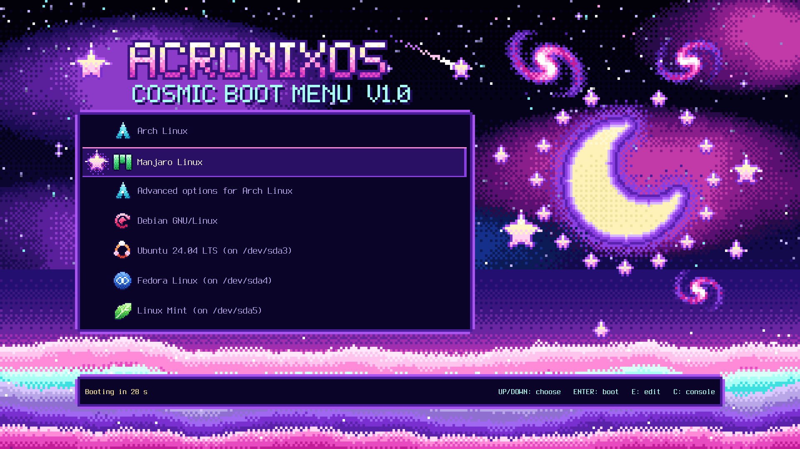
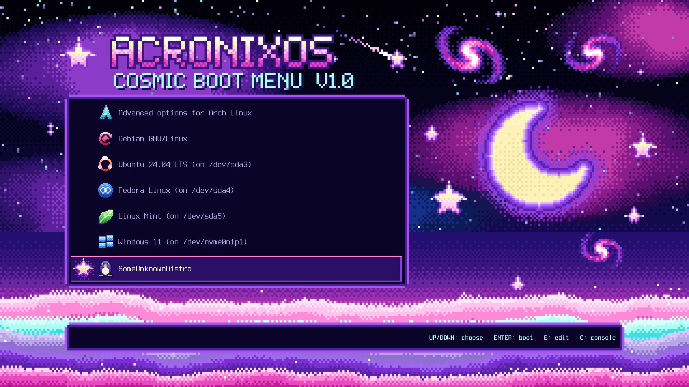
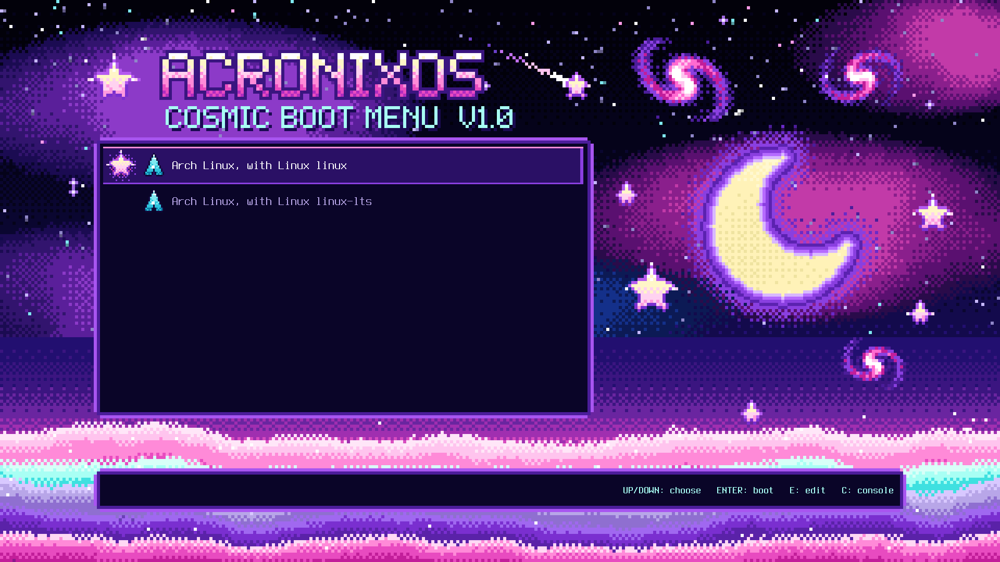

# AcronixOS Cosmic: GRUB theme

Cosmic pixel-art boot menu that continues the `acronixcosmos` Plymouth theme: the same sky, nebulae, crescent moon, five-point stars, spiral galaxies and pink/cyan/violet cloud horizon, drawn with the same generator code. The atmosphere is inspired by the dreamy final-battle skies of the GBA Kirby games. **All art is original**: no sprites, logos or assets from any game.



| | |
|---|---|
|  |  |

Those screenshots are **real GRUB 2.16** (BIOS, VirtualBox), not mock-ups. The 1600x900, 1366x768 and 1280x720 shots are in `previews/`.

## What is on screen

- **Left:** boot menu in a dark panel (readable, nothing busy behind the text). The selected entry gets a violet bar and a glowing pixel star. Submenus ("Advanced options") work as usual.
- **Right:** the moon, galaxies and stars. While the automatic-boot countdown runs, **a ring of 16 stars around the moon disappears one by one**; `Booting in N s` is shown in the footer.
- **Top:** star emblem, `ACRONIXOS` in pixel letters, version label. **Bottom:** countdown and key hints.
- Font: Terminus Bold (bitmap, crisp at its native size). Icons are 16x16 pixel art enlarged x3 (x2 at 720p).

## Install (Arch VM or real machine)

```bash
# from this repo, as root. Shows what it will do and asks before changing anything:
sudo scripts/install_grub_theme.sh                       # resolution auto-detected
sudo scripts/install_grub_theme.sh --resolution 1920x1080
sudo scripts/install_grub_theme.sh --dry-run             # only print the plan
```

It does exactly this:

1. copies the theme for your resolution to `/boot/grub/themes/acronixos-cosmic/` (`/boot/grub2` if that is what you have);
2. writes the settings to a **new drop-in file** `/etc/default/grub.d/99-acronixos-cosmic.cfg` (`GRUB_THEME`, `GRUB_GFXMODE`, `GRUB_GFXPAYLOAD_LINUX=keep`, `GRUB_TIMEOUT_STYLE=menu`, `GRUB_TIMEOUT`, `GRUB_TERMINAL_OUTPUT=gfxterm`). `/etc/default/grub` is **not edited**; the drop-in is read after it, so it wins (also over Debian/Ubuntu's own files there). If your `grub-mkconfig` is too old to read that folder, it appends one marked block to `/etc/default/grub` instead (backed up first);
3. installs `/etc/grub.d/08_acronixos_handoff`, which keeps the cosmic background behind GRUB's text screens (console, editor, errors). It prints nothing unless this theme is the active one;
4. runs `grub-mkconfig` into a temporary file, removes the plain "Loading Linux" lines (next section), checks the result with `grub-script-check`, backs up the old `grub.cfg` and only then replaces it. If the check fails, nothing is replaced.

On Arch in a VM you need only `grub` (and `os-prober` if you want other systems detected). **Set the VM screen to a resolution of the list below** (VirtualBox: Settings > Display, or `GRUB_GFXMODE`). If the firmware has no such mode GRUB falls back to `auto` and the art is scaled by GRUB (blurry but usable).

| Resolution | Scale | Notes |
|---|---|---|
| 1920x1080 | x6 | 7 rows visible |
| 1600x900 | x5 | 5 rows visible |
| 1366x768 | x5 | centre crop of the x5 art |
| 1280x720 | x4 | smallest; used when the screen is smaller than all of them |

GRUB smooths any image it has to scale, so each resolution has its own pre-scaled folder in `acronixos-cosmic/<res>/`; the installer copies the one you need.

### What you see after choosing an entry

GRUB keeps the **themed menu on screen** while it loads the kernel (the highlighted entry and `Booting in 0 s`), then the kernel and the Plymouth splash take over. That only works if nothing prints: some distros make `grub-mkconfig` add `echo 'Loading Linux ...'` / `echo 'Loading initial ramdisk ...'` to every entry, and GRUB then drops to a black text box to show them. The installer removes exactly those lines (any language: a lone `echo` right before `linux`/`initrd`; your own `echo`s are left alone). Pass `--keep-boot-messages` to keep them.

| Distro | Do those lines exist? | Notes |
|---|---|---|
| Manjaro | no: its `10_linux` is built quiet (`quiet_boot="1"`, checked) | nothing to remove |
| Arch | yes by default (upstream `10_linux`; check `grep -n quiet_boot /etc/grub.d/10_linux`) | grub.cfg changes only when **you** run `grub-mkconfig`: re-run the installer or `scripts/grub_quiet_boot.sh /boot/grub/grub.cfg` afterwards |
| Debian / Ubuntu | depends on release/patches | `update-grub` runs on every kernel update and brings the lines back: re-run `scripts/grub_quiet_boot.sh /boot/grub/grub.cfg`. Needs `os-prober` + `GRUB_DISABLE_OS_PROBER=false` to list Windows |
| Fedora / RHEL | no: BLS entries are built at boot, grub.cfg has none | grub.cfg is `/boot/grub2/grub.cfg` (older UEFI installs: the real file is on the ESP, the installer detects it; `--cfg PATH` overrides). Icon class of BLS entries is not verified |

I tried to silence them from inside GRUB (a script function named `echo`) and GRUB 2.16 ignores it: builtins win. So the removal is a post-processing step, not something that survives a later `grub-mkconfig` by itself.

### Rollback

```bash
sudo scripts/uninstall_grub_theme.sh                   # removes drop-in, 08 script, theme (and an old block), regenerates grub.cfg
sudo scripts/uninstall_grub_theme.sh --restore-backup  # also put back the newest /etc/default/grub backup (block method only)
```

If the menu ever looks wrong at boot: press `c` and run `configfile /boot/grub/grub.cfg.acronix-backup-<time>`; from a live USB copy that file over `/boot/grub/grub.cfg`. The installer never touches kernels, `initramfs`, the EFI entry or `grub-install`.

## How OS icons are assigned (and its limits)

GRUB themes cannot detect an operating system. What GRUB's `gfxmenu` does is: for every menu entry it looks for `icons/<class>.png` for each `--class` of the entry, **in order**, and uses the first file that exists. The classes come from the tools that generate the menu, so no config file has to be edited and nothing is overwritten on updates:

| Entry comes from | `--class` list (example) |
|---|---|
| `10_linux` | `arch --class gnu-linux --class gnu --class os` (first word of `GRUB_DISTRIBUTOR`, lowercase) |
| `30_os-prober` (other Linux) | first word of the detected label (`ubuntu`, `fedora`...), then `gnu-linux gnu os` |
| `30_os-prober` (Windows) | `windows --class os` |
| `30_uefi-firmware` | `efi` |
| your own `40_custom` entry | whatever you write after `--class` |

The theme ships `icons/<class>.png` for the base set (`arch debian ubuntu fedora mint manjaro windows linux unknown`) **plus alias copies** for derivatives, e.g. `endeavouros artix garuda cachyos`→Arch, `kali raspbian mx devuan`→Debian, `pop zorin kubuntu`→Ubuntu, `rhel centos rocky almalinux nobara`→Fedora, `linuxmint`→Mint. Edit `ALIASES` in `scripts/make_grub_theme.py` to add more. Anything unrecognised ends on `gnu-linux`/`gnu` (generic penguin) or `os`/`efi` (UEFI chip).

Limitations, honestly:
- A custom entry **without** `--class` gets no icon at all. Add `--class arch` (etc.) to it.
- os-prober labels only the first word. A Linux Mint found by os-prober is labelled `Linux Mint` → class `linux` → generic penguin. A Mint that owns its GRUB (class `linuxmint`) is correct.
- Distributions with an unusual `GRUB_DISTRIBUTOR` fall back to the penguin.
- Icons are chosen per entry, not per name text, so renaming an entry never changes its icon.

## Interaction

Keyboard only: `Up`/`Down` select, `Enter` boots, `Esc` goes back from a submenu, `e` edits the entry, `c` opens the GRUB console; any key stops the countdown. **GRUB 2.16's graphical menu has no mouse support**, so there is none here.

## Customise

Everything under `acronixos-cosmic/<res>/` is generated: do not edit it by hand.

```bash
python3 scripts/make_grub_theme.py        # rebuild all four resolutions (Pillow + grub-mkfont + Terminus bitmap fonts)
scripts/test_grub_vbox.sh 1920x1080 shot.png down enter     # boot the theme in a throw-away VirtualBox VM, screenshot
```

- Layout constants (`PANEL`, `FOOT`, `RING_C`, `TICKS`) and the resolution table (`RES`) are at the top of `scripts/make_grub_theme.py`; positions are in art pixels (320x180 grid).
- Colours, sky, moon, galaxies and stars come from `scripts/make_assets_cosmos.py`, so changing the Plymouth art changes both.
- Icons are the `ico_*` functions (16x16 polygons + dithered ramps + auto outline).
- `scripts/test_grub_vbox.sh` embeds the theme in its own BIOS disk image (it needs VirtualBox, `grub-mkimage`, Python); it never touches your bootloader.

## Troubleshooting

| Symptom | Cause / fix |
|---|---|
| Plain GRUB, no theme | `grub.cfg` was not regenerated, or `GRUB_THEME` path is wrong. Check `grep -n theme /boot/grub/grub.cfg`; re-run the installer. Under UEFI, `/boot/grub` must be readable by GRUB (it is on the root fs or on a partition GRUB can read). |
| Tiny text | The `.pf2` fonts were not loaded. `grub-mkconfig` does that automatically for every `*.pf2` in the theme folder; do not copy the theme by hand without regenerating. |
| Black box with "Loading Linux ..." after choosing an entry | `grub.cfg` was regenerated after the install: run `sudo scripts/grub_quiet_boot.sh /boot/grub/grub.cfg` |
| Menu does not show at all | `GRUB_TIMEOUT_STYLE=hidden` or `GRUB_TIMEOUT=0` in a later file (e.g. `/etc/default/grub.d/*.cfg`). The installer block sets `menu`; check files sourced after it. |
| Blurry / wrong sizes | GRUB used a mode that is not in the table. Pass `--resolution`, or set `GRUB_GFXMODE` to one of the four. |
| No countdown ring | It only exists while a timeout is running; any key press cancels it. |
| Windows missing | `os-prober` is not installed or `GRUB_DISABLE_OS_PROBER=true` (newer GRUB disables it by default). Set it to `false` and regenerate. |

## What was tested (and what was not)

Tested in real GRUB 2.16 (BIOS, VirtualBox): all four resolutions render correctly; with the boot messages removed the themed menu stays up while an entry runs; console (`c`) over the dimmed handoff background; `Up`/`Down`; `Enter` into a submenu and `Esc` back; selection star and bar; scrolling past 7 entries; countdown label and star ring; every icon class listed above including the penguin fallback for an unknown distro; installer/uninstaller on a fake root, both drop-in and old-GRUB block methods (`/etc/default/grub` byte-identical afterwards, re-install idempotent, a Debian-style override file loses to ours); the message filter on Arch-style, Spanish and double-quoted samples; the `08` script with stubbed `grub-mkconfig` helpers (exit 0 and silent when the theme is not active or helpers are missing).

**Not tested yet:** the Debian, Fedora and Arch behaviour in the table above (only Manjaro's file was inspected here); the `08` script inside a real `grub-mkconfig` run; UEFI boot; a real `grub-mkconfig` run on an installed system (the installer's `grub-mkconfig` path, including `grub-script-check` on real output); os-prober on real disks; actually booting the entries (the test menu uses empty entries); real hardware. Please run the installer in your Arch VM first, as planned.

## Credits and licences

Art: original, generated by the scripts in this repository. Font: Terminus (SIL Open Font License 1.1), compiled to `.pf2` with `grub-mkfont`.
